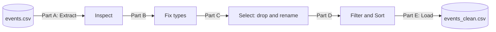
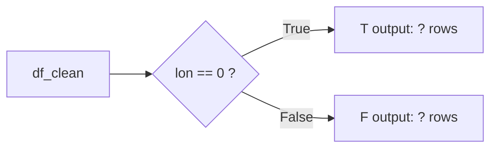

# BAIM 4120 · Class 02 – White Belt
## In-Class Lab: From Alteryx to Python with the TalkingData Events File

| | |
|---|---|
| **Time** | 60 minutes in class |
| **Work mode** | Pairs (one driver, one navigator – switch at Part C) |
| **Submit** | Your completed notebook (`.ipynb`) + answer sheet (Part F) on Canvas by the end of class |
| **Points** | 20 |

---

### Learning objectives

By the end of this lab you will be able to:

1. Load a CSV into pandas and inspect it the way you would with the Alteryx **Browse** tool.
2. Explain why data types matter, and convert columns to the right type (Alteryx **Select**).
3. Filter rows with a boolean mask and split them into True/False outputs (Alteryx **Filter**).
4. Sort, rename, drop, and save data (Alteryx **Sort** and **Output Data**).
5. Describe a workflow using **Extract → Transform → Load (ETL)**.



---

### Setup (5 min)

1. Get the lab files from **https://github.com/iportilla/white-belt**. Run `git clone https://github.com/iportilla/white-belt.git`, or use **Code → Download ZIP**. Keep everything in **one folder**:
   - `Class 2 - In class Exercise Solution.ipynb`. Work in **🟡 Part 1 – STARTER**: fill in every `# TODO` and the 📝 answer cells. Use **🟢 Part 2 – SOLUTION** only to check your work afterwards
   - `Class 02. White Belt events.csv.zip` (the full data, ~65 MB; no need to unzip) **or**, if your laptop struggles, `Class 02. White Belt events_small-1.csv`
   - `README.md` (reference guide – read it if you get stuck)
2. Open the notebook in Jupyter, JupyterLab, VS Code, or Google Colab (in Colab, upload the data file first).
3. **Save a copy as** `Lab02_<LastName1>_<LastName2>.ipynb`. You will submit this copy.
4. Run the **Setup** cell in the Starter. It should print `Using: ...` with your file name.

> ⚠️ **Rule for this lab:** don't just press *Run All*. Run **one cell at a time**, read the output, and answer the questions as you go. You'll be asked to explain what each step does.

---

### Part A – Extract & Browse (10 min) · 4 pts

Complete **Part A** of the Starter (TODOs A0–A3).

**A1.** How many **rows** and **columns** does the file have? Which line of code told you?

**A2.** Before any conversion, what data type does pandas show for **every** column? Why does `pd.read_csv(..., dtype=str)` do this on purpose?

**A3.** Look at `raw.head(10)`. Find a row whose longitude and latitude are both `0.00`. What do you think a location of `0, 0` really means here? (Hint: look up where 0°, 0° is on a map.)

**A4.** In Alteryx you would use the **Browse** tool. Name **two** pandas commands from the notebook that do the same job.

---

### Part B – Select: fixing data types (10 min) · 4 pts

Complete **Part B** of the Starter (TODOs B1–B3).

**B1.** Fill in the table:

| Column | Type before | Type after | pandas function used |
|---|---|---|---|
| `event_id` | | | |
| `device_id` | | | |
| `timestamp` | | | |
| `longitude` | | | |
| `latitude` | | | |

**B2.** How many zeros are in the `longitude` column? What percentage of all rows is that?

**B3.** ⭐ **The device_id trap.** The notebook prints two different "largest" `device_id` values.
- Write down both.
- Explain in 2–3 sentences **why** the text version gets it wrong.
- What would go wrong in a real business report if you didn't catch this?

**B4.** `device_id` has negative values. Should you ever calculate the *average* `device_id`? Why or why not?

---

### Part C – Select: dropping & renaming (8 min) · 3 pts

🔄 **Switch driver and navigator now.**

Complete **Part C** of the Starter.

**C1.** After dropping `timestamp`, how did the notebook **prove** the column is gone? Copy the line of code.

**C2.** Did the number of rows change when you dropped a column? Explain why.

**C3.** The notebook uses `df.drop(...)` but `df` still has `timestamp` afterwards. Why? What would you write to remove it from `df` itself?

---

### Part D – Filter & Sort (12 min) · 5 pts

Complete **Part D** of the Starter.



**D1.** Fill in the two `?` in the diagram above. Show that **T + F = total rows**.

**D2.** What does the `~` symbol do in `df_clean[~mask]`?

**D3. Write your own code.** In the **D3** TODO cell, count the rows where **`lon == 0` but `lat != 0`**. Paste the code and the result.
*Hint:* combine two masks with `&`, and put each condition in parentheses.

**D4.** After sorting, the top row's `device_id` should match one of your answers in B3. Which one?

**D5. Write your own code.** Add a cell that shows the **5 smallest** (most negative) `device_id` values.

---

### Part E – Load & extend (10 min) · 4 pts

Complete **Part E** of the Starter.

**E1.** What does `index=False` do in `to_csv`? What happens if you leave it out? (Try it on `head(5)` and open the file.)

**E2. Write your own code.** Save **only the F output** (rows with a real location) to `events_real_locations.csv`. How many rows did you write?

**E3. Write your own code.** How many **unique devices** are in the data? *Hint:* `nunique()`.

**E4. Write your own code.** Which **calendar day** has the most events, and how many? *Hint:* `df["timestamp"].dt.date.value_counts()`.

---

### Part F – Answer sheet & reflection

Add a **Markdown cell at the very top** of your notebook with:

```markdown
## Lab 02 – Answer Sheet
**Names:** ________ , ________
**Data file used:** full / small

| # | Answer |
|---|---|
| A1 | |
| ... | |
| E4 | |

**Reflection (3–4 sentences):** Compare doing this in Alteryx vs. Python.
What was easier in each? When would you pick one over the other?
```

---

### Grading rubric (20 pts)

| Part | Points | Full credit means… |
|---|---|---|
| A – Extract & Browse | 4 | All four answered with correct numbers and code references |
| B – Data types | 4 | Table complete; B3 explains the text sort correctly |
| C – Drop & rename | 3 | Correct answers and code for C3 |
| D – Filter & sort | 5 | D1 adds up; D3 and D5 code runs and is correct |
| E – Load & extend | 4 | E2–E4 code runs and is correct |
| Reflection | — | Required for submission (no reflection = −2) |

**Submission checklist**
- [ ] Notebook renamed `Lab02_<LastName1>_<LastName2>.ipynb`
- [ ] Answer sheet cell at the top is filled in
- [ ] Every `# TODO` in the Starter is filled in and **runs without errors**
- [ ] *Kernel → Restart & Run All* works start to finish (it's fine to delete the Solution section from your copy)
- [ ] **Do not** upload the CSV files – only the `.ipynb`

---

### Stretch challenge (optional, +2 bonus)

Rebuild Parts B–D in **Alteryx** using Input Data → Select → Filter → Sort, and check that your Alteryx row counts match your Python ones. Submit a screenshot of the workflow with the record counts showing.

> 💬 Stuck? Read `README.md` first, then ask your neighbour, then post in **#ba-homework-help** on Slack.
