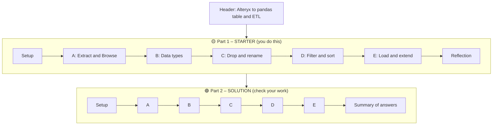
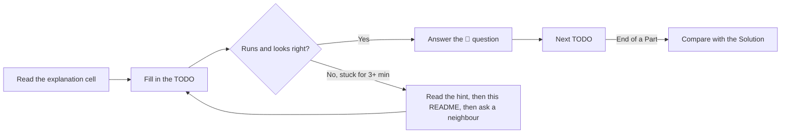
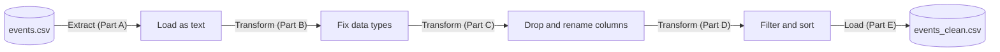
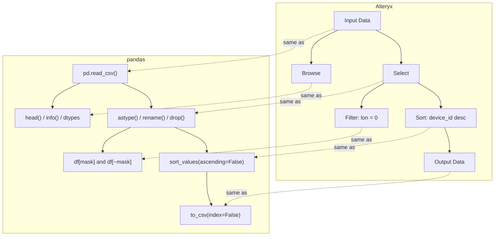
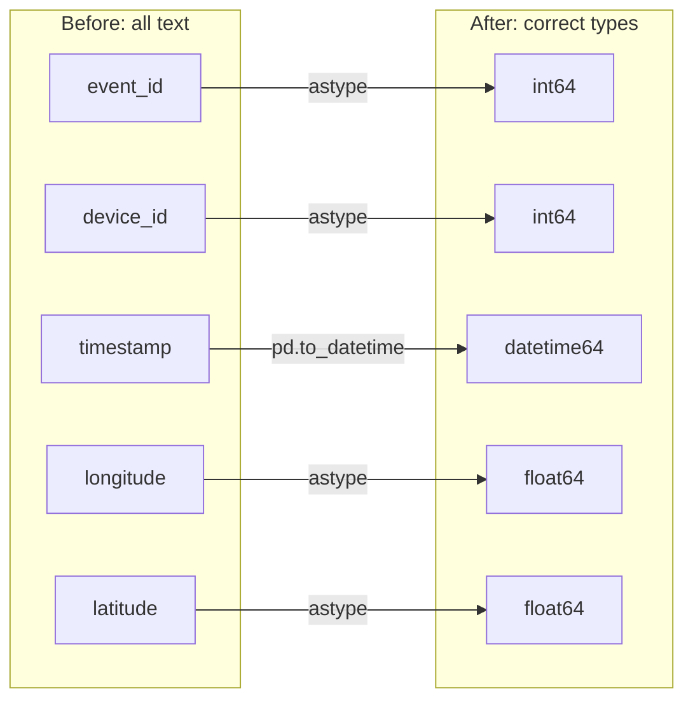
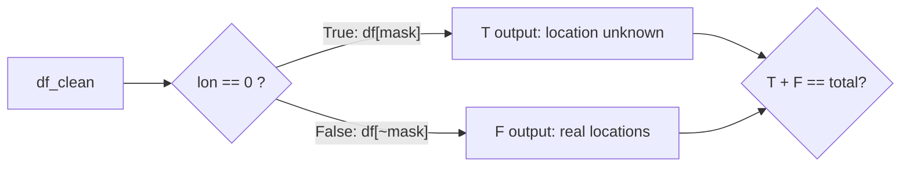

# Class 02 – White Belt: In-Class Exercise (Python Notebook)

This README explains **`Class 2 - In class Exercise Solution.ipynb`**. The notebook does the same thing in Python that the Alteryx workflow **`Class 2 - In class Exercise Solution.yxmd`** does: it loads a large CSV of mobile-app events, sets the data types, answers questions about the data, and saves a cleaned copy.

It goes with the lab handout **`Class 02 - In-Class Lab.md`**. Question IDs such as **A1, B3, D5** are the same in the lab, the notebook, and this README.

> 💡 This README explains **concepts and how things work**. It does **not** give the lab answers. You'll find those in the notebook's Solution section, after you've tried the Starter yourself.

---

## 1. What's in the folder

| File | What it is |
|---|---|
| `Class 2 - In class Exercise Solution.ipynb` | The notebook, with a **Starter** section and a **Solution** section |
| `Class 02 - In-Class Lab.md` | The lab handout: questions, rubric, submission checklist |
| `Class 2 - In class Exercise Solution.yxmd` | The same workflow built in Alteryx |
| `Class 02. White Belt events.csv.zip` | Full dataset, zipped (~65 MB; ~195 MB and about 3.25 M rows unzipped). The notebook reads the zip directly |
| `Class 02. White Belt events_small-1.csv` | Small dataset (10,000 rows), for slower laptops |
| `README.md` | This file |

---

## 2. Setup

| Requirement | How to check / install |
|---|---|
| Python 3.10+ | `python3 --version` |
| pandas 2.x or 3.x | `pip install pandas` |
| Jupyter | `pip install notebook`, or use VS Code / JupyterLab / Google Colab |

Clone the repo (or use **Code → Download ZIP** on GitHub), then open the notebook from the repo folder:

```bash
git clone https://github.com/iportilla/white-belt.git
cd white-belt
jupyter notebook "Class 2 - In class Exercise Solution.ipynb"
```

The notebook looks for the full data as `events.csv` (if you unzipped it) or `events.csv.zip`, and uses the small file if neither is there. To force the small file (for example, if your laptop runs out of memory), change the last line of the Setup cell to `DATA_FILE = SMALL_FILE`.

---

## 3. How the notebook is organised

The notebook has **two sections** that cover the same five parts:



| Section | Cells look like… | What you do |
|---|---|---|
| **🟡 Starter** | Explanation cells, then code cells with `# TODO` and `None` / `...` placeholders, then 📝 answer cells | Replace the placeholders with working code and type your written answers |
| **🟢 Solution** | Finished code, explanations of *why* it works, and a summary table | Open it **after** you try each part, to compare |

**Things to know:**
- The Solution **doesn't depend on the Starter**. It reloads the data from scratch, so you can run it any time.
- Starter cells will **raise errors until you fill them in**, because `None.head()` doesn't work. That's expected.
- Every cell is tagged `starter` or `solution` in its metadata (*View → Cell Toolbar → Tags* in classic Jupyter). Instructors can use the tags to make a Starter-only copy.

### Suggested way to work



---

## 4. The big picture: ETL

The notebook follows **Extract → Transform → Load**, which shows up in almost every data workflow.



---

## 5. Alteryx tool → pandas code



| Alteryx tool | pandas | Lab part |
|---|---|---|
| Input Data | `pd.read_csv(path, dtype=str)` | A |
| Browse | `df.head()`, `df.info()`, `df.dtypes` | A |
| Select – change types | `.astype()`, `pd.to_datetime()` | B |
| Select – drop / rename | `.drop(columns=...)`, `.rename(columns=...)` | C |
| Filter | `df[mask]` (T output), `df[~mask]` (F output) | D |
| Sort | `.sort_values()`, `.nsmallest()` | D |
| Output Data | `.to_csv(path, index=False)` | E |

---

## 6. The data

The data comes from the Kaggle **TalkingData** competition. Each row is one moment when a person used an app on their phone.

| Column | Meaning | Example |
|---|---|---|
| `event_id` | Unique ID of the event | `654` |
| `device_id` | ID of the phone/person. Can be **negative**, because it's a label, not a quantity | `-845139532698223858` |
| `timestamp` | When it happened | `2016-05-05 00:49:37` |
| `longitude` | Where it happened (east–west) | `116.31` |
| `latitude` | Where it happened (north–south) | `39.93` |

---

## 7. Concepts by part

### Part A – Extract & Browse

**Reading a CSV.** A CSV is plain text with no type information. `pd.read_csv(path, dtype=str)` reads **every column as text** on purpose. That's what Alteryx and Excel do by default, and it gives you a clear "before" state.

| You want to… | Use |
|---|---|
| See some rows | `df.head(10)` |
| Count rows and columns | `df.shape` returns a tuple `(rows, columns)`. Unpack it: `n_rows, n_cols = df.shape` |
| See the column types | `df.dtypes` or `df.info()` |
| Keep only rows that match | `df[df["col"] == "value"]` |

> While a column is text, compare it to **text**: `raw["longitude"] == "0.00"`, not `== 0`.

In pandas 2.x, text shows up as `object`. In pandas 3.x it shows up as `str`. Both mean the same thing.

### Part B – Data types



| Type | pandas | Alteryx |
|---|---|---|
| Whole number | `int64` | Int64 |
| Decimal | `float64` / `float32` | Double / Float |
| Date-time | `datetime64` | DateTime |
| Text | `object` / `str` | V_String / V_WString |

**Counting with masks.** `True` counts as 1 and `False` as 0, so `(df["col"] == 0).sum()` **counts** the matches and `.mean()` gives the **fraction**.

**Why types matter: text vs. number comparison.** Text is compared one character at a time, like words in a dictionary. So:

| Values | Compared as text | Compared as numbers |
|---|---|---|
| `"999"` vs `"1000"` | `"999"` is bigger (`9` > `1`) | `1000` is bigger |

Nothing crashes. You just get the wrong answer, silently. **Set types before you sort, compare, or calculate.** Question B3 asks you to find this happening in the real data.

**IDs aren't quantities.** If doing arithmetic on a column means nothing (the "average phone number"), treat it as an ID or a category, even if it looks like a number.

### Part C – Dropping & renaming

```python
df_no_time = df.drop(columns=["timestamp"])          # returns a NEW DataFrame
df_clean   = df.rename(columns={"longitude": "lon"})  # also returns a new one
```

> Most pandas methods **return a new DataFrame** and leave the original alone. To keep a change, assign the result to a variable. To change `df` itself, write `df = df.drop(...)`.

To check that a column is gone: `"timestamp" in df_no_time.columns` → `False`.

### Part D – Filter & Sort

The Alteryx Filter tool has **T** and **F** outputs. In pandas, a **boolean mask** gives you both:



```python
mask = df_clean["lon"] == 0
filter_true  = df_clean[mask]     # T output
filter_false = df_clean[~mask]    # F output  (~ means NOT)
```

**Combining conditions:** use `&` (and), `|` (or), `~` (not), and **always** put each condition in parentheses:

```python
(df["lon"] == 0) & (df["lat"] != 0)     # ✅
 df["lon"] == 0  &  df["lat"] != 0      # ❌ & runs before ==
```

**Sorting:** `sort_values("col", ascending=False)` puts the largest first. `df.nsmallest(5, "col")` is a shortcut for the 5 smallest. If one ID appears in many rows, use `drop_duplicates()` first to get 5 *different* values.

> **A note on `0, 0`.** Latitude 0, longitude 0 is in the Atlantic Ocean. In this data it's a **placeholder for missing GPS**, not a real place. Real datasets always have oddities like this. Finding them is part of the job.

### Part E – Load & extend

```python
df.to_csv("events_clean.csv", index=False)
```

`index=False` keeps pandas' row numbers out of the file. If you leave it out, reading the file back gives you an extra `Unnamed: 0` column. (Question E1 has you try both.)

Two more tools for the extension questions:

| You want to… | Use |
|---|---|
| Count distinct values | `df["col"].nunique()` |
| Get the date part of a timestamp | `df["timestamp"].dt.date` (also `.dt.hour`, `.dt.day_name()`) |
| Count how often each value appears | `.value_counts()` (most common first) |

> ⚠️ With the full dataset, the Solution writes several large files (`events_clean.csv`, `events_real_locations.csv`, 100–200 MB each) plus two small `demo_*.csv` files. Delete them when you're done. **Don't upload them to Canvas.**

---

## 8. Troubleshooting

| Problem | Likely cause / fix |
|---|---|
| `AttributeError: 'NoneType' object has no attribute ...` | You haven't filled in a `# TODO` above this cell yet |
| `NameError: name 'raw' is not defined` | Run the cells in order. Restart and run from the top |
| `FileNotFoundError` | The data file isn't in the same folder as the notebook, or the file name is different. Start Jupyter from the repo folder |
| Kernel crashes / out of memory | Use the small file (`DATA_FILE = SMALL_FILE`) |
| `TypeError` or wrong result when combining conditions | Missing parentheses around each condition |
| Your numbers don't match the Solution | Check you're using the same data file. The small file gives smaller numbers |
| dtypes show `object` instead of `str` | Normal on pandas 2.x. Both mean text |

---

## 9. Submitting the lab

See the checklist in `Class 02 - In-Class Lab.md`. In short: rename your copy, fill in every `# TODO` and 📝 cell, make sure *Kernel → Restart & Run All* works, and upload **only the `.ipynb`**.
